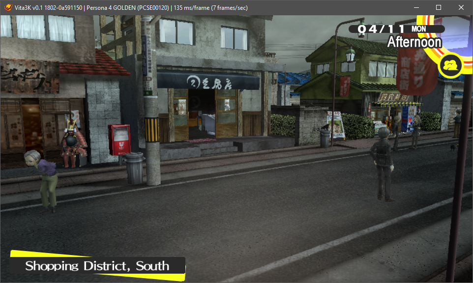

# Vita3K

## Introduction

Vita3K is an experimental PlayStation Vita emulator for Windows, Linux, macOS and Android.

* [Website](https://vita3k.org/) (information for users)
* [Wiki](https://github.com/Vita3K/Vita3K/wiki) (information for developers)
* [Discord server](https://discord.gg/MaWhJVH) (recommended)

## Vita3K Android Update

### Base version

This update started from Vita3K upstream `master` at commit `99ec7cad` (`kernel: share one wait loop between sync objects`). The checkout is now synchronized with upstream `master` through commit `6ec8e6ce` (`overlay: use existing bold CJK firmware fonts`), while retaining the Android overlay work described below.

### Upstream Vita3K changes included

* **Synchronization:** Shares a wait loop between synchronization objects.
* **System memory:** Enforces the Vita user-memory budget in `sceKernelAllocMemBlock`.
* **CPU execution:** Fixes handling of a guest function executing in the first memory page.
* **Shader output:** Clamps vertex `COLOR0` and `COLOR1` outputs to the `[0, 1]` range.
* **Build requirements:** Raises the minimum Boost version to 1.82.
* **C++ cleanup:** Modernizes C++ patterns for readability across core, Android JNI, and other platform code.
* **Synchronization callbacks:** Runs callbacks notified during a wait before the wait returns.
* **CPU diagnostics:** Logs invalid guest accesses in full only when `LOG_INVALID_ACCESS` is enabled.
* **Logging:** Installs the termination handler only once.
* **OpenGL compatibility:** Adds a workaround for AMD integrated GPUs.
* **PVRTC textures:** Decodes PVRTC textures before Vulkan RGBA8 uploads.
* **Vulkan portability:** Negotiates Vulkan portability enumeration when available.
* **NGS player buffers:** Advances to the next populated player buffer when the current slot is unavailable or empty.
* **SDL input:** Forwards mouse and keyboard input correctly through the SDL frontend.
* **Kernel timers:** Adds kernel timer event support.
* **CJK firmware fonts:** Uses available bold firmware fonts when the preferred Japanese, Chinese, or Korean font files are unavailable.

### Android overlay and editor changes

* Added direct tap-to-select for controls in the on-screen overlay editor, with navigation controls available as an alternative.
* Hidden controls remain visible but dimmed while editing, so they can be selected and re-enabled.
* Added per-control visibility, size, and opacity adjustments.
* Added per-stick sensitivity for the left and right thumb sticks. The value is stored separately for each stick and ranges from 10% to 200%; 100% preserves the normal response. The multiplier is applied to the stick's X/Y output and clamped to the valid axis range.
* Saved the new sensitivity value with the overlay layout. Existing layouts without a saved sensitivity value default to 100%.
* Applied style changes to the live overlay drawables and improved edit-pointer tracking to avoid unnecessary drawable recreation and reduce pointer-related edit problems.
* Improved editor text contrast and connected the editor to the pause-menu and settings layout flows.

### Build validation

The Android `assembleReldebug` build completed successfully after the original upstream updates and local Android changes were combined. The resulting APK was verified as a readable APK archive with one signer. A post-sync rebuild was not run in the current sandbox because no Android SDK is configured. Gameplay behavior was not tested on a physical device.

### Source package note

The Android-only source archive contains the Gradle Android project (`android/`) and the Vita3K Android JNI bridge (`vita3k/android/`). It intentionally excludes the shared Vita3K native core and other platform modules to keep the archive smaller, so it is not a standalone build tree. To compile the full Android app, use the complete Vita3K source checkout with its required submodules and dependencies.

## Compatibility

The emulator currently runs most homebrew programs and commercial games.

- [Homebrew compatibility page](https://vita3k.org/compatibility-homebrew.html)
- [Commercial compatibility page](https://vita3k.org/compatibility.html)

## Gallery

|               **Persona 4 Golden** by Atlus                   |                     **A Rose in the Twilight** by Nippon Ichi Software                         |
| :-----------------------------------------------------------: | :--------------------------------------------------------------------------------------------: |
|  |  |

|                  **Alone with You** by Benjamin Rivers                     |                 **VA-11 HALL-A** by Sukeban Games                    |
| :------------------------------------------------------------------------: | :------------------------------------------------------------------: |
|  |  |

|              **Fruit Ninja** by Halfbrick Studios                  |                **Jetpack Joyride** by Halfbrick Studios                    |
| :----------------------------------------------------------------: | :------------------------------------------------------------------------: |
|  |  |

## License

Vita3K is licensed under the **GPLv2** license. This is largely dictated by external dependencies, most notably Unicorn.

## Downloads

You can download the latest builds from [here](https://github.com/Vita3K/Vita3K/releases/tag/continuous).

* Windows
  * Requirements:
    * [Microsoft Visual C++ 2015-2022 Redistributable](https://aka.ms/vs/17/release/vc_redist.x64.exe)
* Linux
  * Arch based:
    * [vita3k-bin](https://aur.archlinux.org/packages/vita3k-bin)<small>AUR</small>
    * [vita3k-git](https://aur.archlinux.org/packages/vita3k-git)<small>AUR</small>
  * Requirements:
    * xdg-desktop-portal
    * OpenGL or Vulkan runtime libraries
* Android
    * [Adreno drivers](https://github.com/K11MCH1/AdrenoToolsDrivers/releases/)
* Others
  * [Download Artifact](https://github.com/Vita3K/Vita3K/actions?query=event%3Apush+is%3Asuccess+branch%3Amaster)
  * [Old builds](https://github.com/Vita3K/Vita3K-builds/releases)

## Building

Please see [`building.md`](./building.md).

## Running
Check our [quickstart guide](https://vita3k.org/quickstart) to make sure your computer meets the minimum requirements to run Vita3K.  
Don't forget to have your graphics driver up to date and to install the [Visual C++ 2015-2022 Redistributable](https://aka.ms/vs/17/release/VC_redist.x64.exe) if you are a Windows user.  

## Bugs and issues
The project is in an early stage, so please be mindful when opening new issues. Expect crashes, glitches, low compatibility and poor performance.

## Thanks
Thanks go out to people who offered advice or otherwise made this project possible, such as Davee, korruptor, Rinnegatamante, ScHlAuChi, Simon Kilroy, TheFlow, xerpi, xyz, Yifan Lu and many others.

## Donations

 
Thank you to the supporters and to all those who support us on our [ko-fi](https://ko-fi.com/vita3K).
* Among them, those who subscribed to the Nibble Tier and upper: **j0hnnybrav0, Mored4u, TacoOblivion, Undeadbob and uplush**

## Note
The purpose of this emulator is not to enable illegal activity. You can dump games from a Vita by using [NoNpDrm](https://github.com/TheOfficialFloW/NoNpDrm) or [FAGDec](https://github.com/CelesteBlue-dev/PSVita-RE-tools/tree/master/FAGDec/build). You can get homebrew programs from [VitaDB](https://www.rinnegatamante.eu/vitadb/#/).

PlayStation, PlayStation Vita and PlayStation Network are all registered trademarks of Sony Interactive Entertainment Inc. This emulator is not related to or endorsed by Sony, or derived from confidential materials belonging to Sony.
